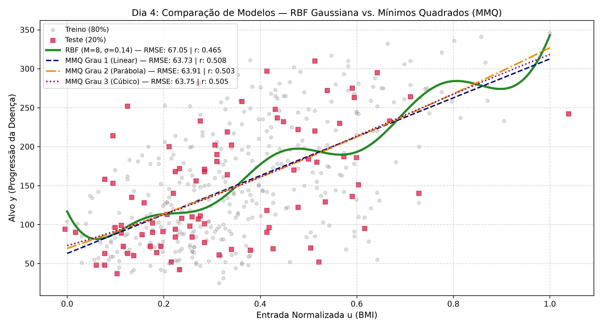
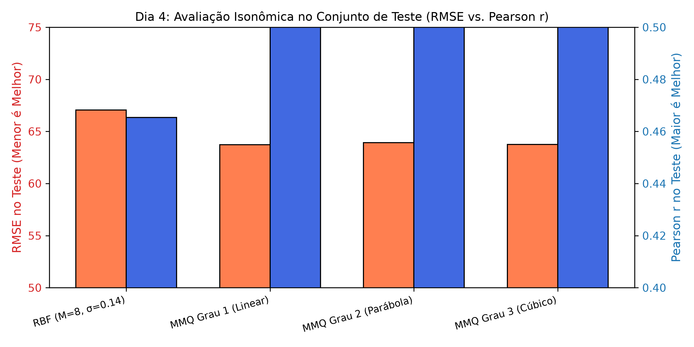
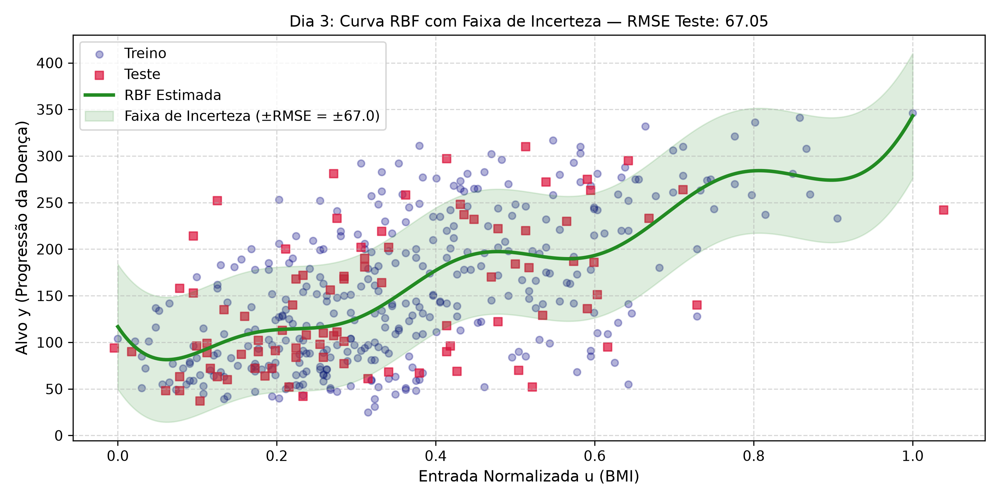
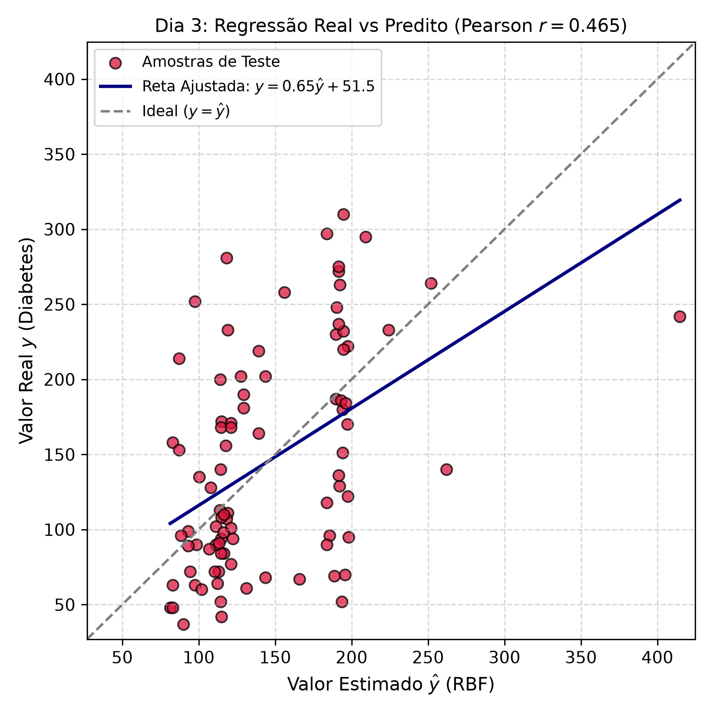

# 📉 Ajuste de Curvas Não-Lineares: Redes RBF Gaussianas vs. Mínimos Quadrados (MMQ)

<p align="center">
  
  
  
  
  
  
</p>

Projeto de pesquisa e identificação de sistemas desenvolvido para a disciplina **ECT-3401 — Computação Numérica** na Universidade Federal do Rio Grande do Norte (UFRN).  
* **Docente:** Prof. Joilson B. A. Rego  
* **Discente:** Jacson Arruda Ribeiro  
* **Dataset Clínico:** `load_diabetes` (scikit-learn) — 442 pacientes com relação entre Índice de Massa Corporal (IMC) e progressão contínua da doença.

---

## 🎯 Visão Geral do Projeto

Este repositório contém a implementação matemática do zero e a avaliação experimental comparativa entre duas abordagens fundamentais de aproximação de funções:
1. **Redes de Base Radial (RBF Gaussianas):** Abordagem de suporte local baseada em funções gaussianas $\phi_j(u) = \exp\left(-\frac{\|u-c_j\|^2}{2\sigma^2}\right)$, projetadas para capturar não-linearidades e curvaturas regionais complexas.
2. **Método dos Mínimos Quadrados (MMQ / OLS Polinomial):** Abordagem clássica de base monomial global canônica via Matriz de Vandermonde $V \in \mathbb{R}^{N \times (d+1)}$ (Graus 1, 2 e 3).

### 🔬 Protocolo Científico Estrito (Prevenção de *Data Leakage*)
* **Particionamento:** 80% Treino ($N = 353$) e 20% Teste ($N = 89$), com semente estocástica reproduzível (`random_state=42`).
* **Normalização Min-Max:** Os limites $[\min, \max]$ foram calculados **exclusivamente sobre o conjunto de treinamento** e congelados para projetar as amostras de teste, eliminando qualquer vazamento estatístico de informação.
* **Resolução Numérica Estável:** Emprego da Decomposição em Valores Singulares (SVD) via pseudoinversa de Moore-Penrose (`np.linalg.pinv`) para garantir estabilidade numérica mesmo diante de matrizes mal-condicionadas.

---

## 📊 Síntese Comparativa de Desempenho (Isonomia Amostral)

| Modelo | Parâmetros Livres | RMSE Treino ($N=353$) | RMSE Teste ($N=89$) | Pearson $r$ (Teste) | Número de Condição ($\kappa$) | Veredito Científico |
| :--- | :---: | :---: | :---: | :---: | :---: | :--- |
| **RBF Gaussiana ($M=8, \sigma=0{,}1429$)** | 9 | **60,95** | 67,05 | 0,4653 | $1,42 \times 10^5$ | **Venceu no Treino** (Baixo Viés, Flexibilidade Local) |
| **MMQ Grau 1 (Linear)** | 2 | 62,08 | **63,73** | **0,5076** | **36,2** | **Venceu no Teste** (Baixa Variância, Navalha de Occam) |
| **MMQ Grau 2 (Parábola)**| 3 | 62,04 | 63,91 | 0,5034 | 970 | Degradação ligeira de teste, sem ganho preditivo |
| **MMQ Grau 3 (Cúbica)**  | 4 | 62,04 | 63,75 | 0,5052 | 24.300 | Explosão de $\kappa$ (risco de cancelamento catastrófico) |

---

## 📈 Prova Visual dos Resultados

### 1. Confrontação de Modelagem: RBF Gaussiana vs. Polinômios MMQ
<p align="center">
  
</p>

### 2. Generalização Preditiva: Erro RMSE (Treino vs. Teste)
<p align="center">
  
</p>

<details>
<summary><b>🔍 Clique para expandir os Gráficos de Incerteza e Calibração OLS</b></summary>
<br>

<p align="center">
  <b>Ajuste RBF com Faixa de Incerteza ($\pm \text{RMSE}$)</b><br>
  
</p>

<p align="center">
  <b>Reta de Calibração Real vs. Predito ($y = 0{,}6460\hat{y} + 51{,}48$)</b><br>
  
</p>
</details>

### 💡 Principais Descobertas de Baixo Nível:
1. **O Dilema Viés-Variância:** A RBF Gaussiana alcançou o menor erro de treinamento ($\text{RMSE} = 60{,}95$) devido aos seus 9 graus de liberdade locais, mas sofreu maior dispersão ao generalizar para dados inéditos ($\text{RMSE} = 67{,}05$).
2. **A Navalha de Occam (*Lex Parsimoniae*):** Diante de ruído biológico estocástico, o modelo linear simples (2 parâmetros) atuou com regularização natural, superando todos os polinômios de ordem superior e a RBF no conjunto de teste ($\text{RMSE} = 63{,}73$ e $r = 0{,}5076$).
3. **Instabilidade do IEEE 754 em Vandermonde:** Conforme o grau polinomial subiu de 1 para 3, o número de condição saltou de $36{,}2$ para $24.300$ (aumento de quase 1.000x), acarretando perda imediata de 4 a 5 dígitos decimais de precisão na inversa em ponto flutuante de 64 bits.

---

## 📁 Estrutura do Repositório

```text
.
├── src/                      # Módulos centrais dos algoritmos
│   ├── data_loader.py        # Divisão treino/teste e MinMax sem data leakage
│   ├── rbf_model.py          # RBF Gaussiana, matriz Phi, cond(Phi^T Phi) e pinv SVD
│   ├── polynomial_mmq.py     # Modelo de Mínimos Quadrados (MMQ / OLS)
│   └── metrics.py            # Cálculo de EMQ, RMSE, Pearson e regressão de calibração
├── tests/                    # Validações experimentais e testes de etapas
│   ├── test_data_loader.py   # Validação de amostragem e isolamento de teste (Dia 1)
│   ├── test_rbf.py           # Validação da RBF e geração de curvas de resposta (Dia 2)
│   ├── test_metrics.py       # Avaliação de EMQ, Pearson e calibração da RBF (Dia 3)
│   └── test_comparison_mmq.py# Comparativo isonômico: RBF vs. MMQ Graus 1, 2 e 3 (Dia 4)
├── docs/                     # Documentação e artefatos de entrega
│   ├── figuras/              # Gráficos em alta resolução gerados pelo pipeline
│   └── relatorio/            # Artigo formal em LaTeX e PDF de 7 páginas compilado (Dia 5)
├── fundamentacao_teorica.md  # Teoria exaustiva e banco de 66 questões para defesa oral
├── .gitignore                # Regras de exclusão de artefatos temporários
└── README.md                 # Apresentação institucional e guia de execução
```

---

## 🚀 Como Reproduzir o Projeto

### 1. Clonar e Configurar o Ambiente
```bash
# Clone o repositório
git clone https://github.com/Jacsonrn/ufrn-ect3401-rbf-curve-fitting.git
cd ufrn-ect3401-rbf-curve-fitting

# Crie e ative o ambiente virtual
python -m venv .venv
# Windows:
.venv\Scripts\activate
# Linux/Mac:
source .venv/bin/activate

# Instale os pacotes necessários
pip install numpy matplotlib scikit-learn
```

### 2. Executar a Suíte Completa de Validação
```bash
# Dia 1: Carregamento e Normalização Min-Max sem Leakage
python tests/test_data_loader.py

# Dia 2: Ajuste da RBF Gaussiana via SVD
python tests/test_rbf.py

# Dia 3: Métricas de EMQ, RMSE, Pearson e Reta de Calibração
python tests/test_metrics.py

# Dia 4: Comparativo Isonômico RBF vs. Polinômios MMQ
python tests/test_comparison_mmq.py
```

### 3. Visualizar o Relatório Técnico Formal
O artigo científico final com 7 páginas estruturado no padrão ABNT/UFRN para publicação está disponível em:
* Código-fonte LaTeX: [`docs/relatorio/relatorio_final_projeto_u2.tex`](docs/relatorio/relatorio_final_projeto_u2.tex)
* Documento PDF compilado: [`docs/relatorio/relatorio_final_projeto_u2.pdf`](docs/relatorio/relatorio_final_projeto_u2.pdf)

---

## 👨‍💻 Autor
**Jacson Arruda Ribeiro**  
Universidade Federal do Rio Grande do Norte (UFRN) — Centro de Tecnologia (CT / ECT)  
Discente em Engenharia de Computação
